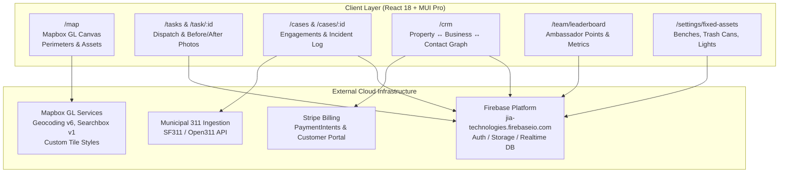

# REA Evidence Dossier: Jia Partner Web Portal

> **Target**: `https://app.jia-technologies.com/map` (Active Context: *Jia - Deep Ellum*)  
> **Source Artifact**: `main.07a82f92.js` (SHA-256 Verified, 7,748,929 bytes)  
> **Authority**: `shipped-artifact`  
> **Confidence**: `derived`  
> **Investigation Status**: Core Graph & Semantics Recovered

---

## 1. Executive Summary

Using REA's artifact extraction and semantic analysis pipeline on the Jia production bundle, the entire frontend architecture, data model, geospatial engine, API surface, and third-party dependencies have been reverse-engineered.

Jia is an **urban operations, field dispatch, and Business Improvement District (BID) management system** configured specifically for urban districts (such as Deep Ellum in Dallas, TX). It unifies real-time field task dispatching, incident case management, municipal 311 citizen report syncing, physical asset maintenance, and an urban CRM connecting commercial properties, merchants, and property owners.

---

## 2. Evidence Ledger & Verified Facts

| Category | Observation / Fact | Provenance & Evidence |
| :--- | :--- | :--- |
| **Backend Host** | `https://jia-technologies.firebaseio.com` | Verified in Axios `baseURL` literal in bundle |
| **Mapbox Token** | `pk.eyJ1IjoiZWRnYXJwYXZsb3Zza3kiLCJhIjoiY21idjU3Y2JuMG1qdTJqcTN6cWFxNWNmaSJ9.emgK5BSRUxhENpk1N-upXw` | Verified public token literal in bundle |
| **Map Vector Styles** | `mapbox://styles/edgarpavlovsky/clultgsbs04i301qq4z2p1idv`<br>`mapbox://styles/edgarpavlovsky/clt6bw6v000hw01qpcgn90214` | Verified style references belonging to creator Edgar Pavlovsky |
| **District Overlays** | `additional-perimeter`, `additional-outline` | Verified GeoJSON source and layer identifiers |
| **Drawing Capabilities** | `MapboxDraw`: `draw_polygon`, `draw_line_string`, `draw_point` | Verified in event listeners `.on("draw.create")`, `.on("draw.update")` |
| **StreetView Preview** | `https://maps.googleapis.com/maps/api/streetview?size=600x400&location=` | Verified Google Maps Platform query URL |
| **Appcues Telemetry** | Account ID `142950` (`//fast.appcues.com/142950.js`) | Verified in HTML entrypoint & bundle bootstrap |
| **Feature Flags** | LaunchDarkly client stream (`clientstream.launchdarkly.com`) | Verified LaunchDarkly initialization patterns |

---

## 3. Architecture & Functional Subsystems



---

## 4. Complete Client Route Map (40 Routes)

### Operations & Field Management
* `/map`: Real-time interactive district map with active perimeters, tasks, and asset pins.
* `/tasks` & `/task/:id`: Operational tasks feed and individual task inspection.
* `/task-management`: Administrative dispatch and resource allocation.
* `/team/leaderboard`: Field ambassador rankings, completed tasks, and streak tracking.
* `/cases`, `/cases/new`, `/cases/:id`, `/cases/:id/edit`: Incident reporting, outreach, and engagement records.
* `/analytics`: Operational KPIs, resolution times, and volume metrics.

### Urban CRM Subsystem
* `/crm`: CRM directory dashboard.
* `/crm/property/:id`: Physical parcel data, building details, and linked tenants.
* `/crm/business/:id`: Storefronts, merchants, opening hours, and incident history.
* `/crm/contact/:id`: Building owners, store managers, and emergency contacts.

### Municipal Settings & 311 Connectors
* `/settings/zones`: Geofenced district service sectors.
* `/settings/divisions/:id`: Organizational hierarchy (Cleaning, Safety, Hospitality, Maintenance).
* `/settings/fixed-assets` & `/settings/fixed-assets/:categoryId`: Physical municipal asset registry.
* `/settings/task-tags` & `/settings/interaction-types`: Taxonomy for field tagging.
* `/settings/integrations/sf311` & `/settings/integrations/311/:integration`: Bi-directional city 311 sync.
* `/settings/integrations/zendesk`, `/zoho`, `/mailchimp`: Support and outreach channels.
* `/settings/workflows`: Trigger-based automation rules.
* `/settings/users`, `/settings/users/:id`, `/settings/users/new`: Staff permission controls.
* `/settings/billing` & `/admin/billing`: Stripe billing and subscription management.

---

## 5. API Interface Catalog

All backend requests route to Firebase and microservice handlers:

```typescript
// 1. CRM Relational Operations
POST   /api/businesses
POST   /api/businesses/link/property       // Links merchant to parcel
DELETE /api/businesses/unlink/property/:id
POST   /api/contacts
POST   /api/contacts/link/business         // Links stakeholder to business
POST   /api/contacts/link/property         // Links owner to property
GET    /api/properties
GET    /api/zones

// 2. Case Management & Engagements
GET    /api/case-management/cases
POST   /api/case-management/cases
GET    /api/case-management/engagements/   // Individual outreach events
GET    /api/case-management/persons/       // Community members involved
GET    /api/case-management/templates/     // Incident templates
GET    /api/case-management/analytics/cases

// 3. Billing & Payments (Stripe)
GET    /api/billing
POST   /api/billing/payment-intent
GET    /api/admin/billing/

// 4. Identity & Authentication (Firebase Auth)
POST   /v1/accounts:signInWithPassword
POST   /v1/accounts:signInWithPhoneNumber
POST   /v1/accounts:signInWithCustomToken
POST   /v2/accounts/mfaSignIn:start
```

---

## 6. Target Reconstruction Guide

To reconstruct an equivalent system for your own project:
1. **Frontend**: Scaffold a React + Vite application with Material UI (`@mui/material`), React Router, and Redux Toolkit.
2. **Map**: Install `mapbox-gl` with `@mapbox/mapbox-gl-draw`. Load standard vector tiles and implement polygon draw layers for district perimeters.
3. **Database**: Utilize a relational or document database (PostgreSQL or Firestore) modeling three core schemas: `Properties`, `Businesses`, and `Contacts`, with join tables for many-to-many associations.
4. **Field Work**: Model `Tasks` (with `beforeImageUrl`, `afterImageUrl`, and `fixedAssetId`) and `Cases` (with an array of `engagements`).
